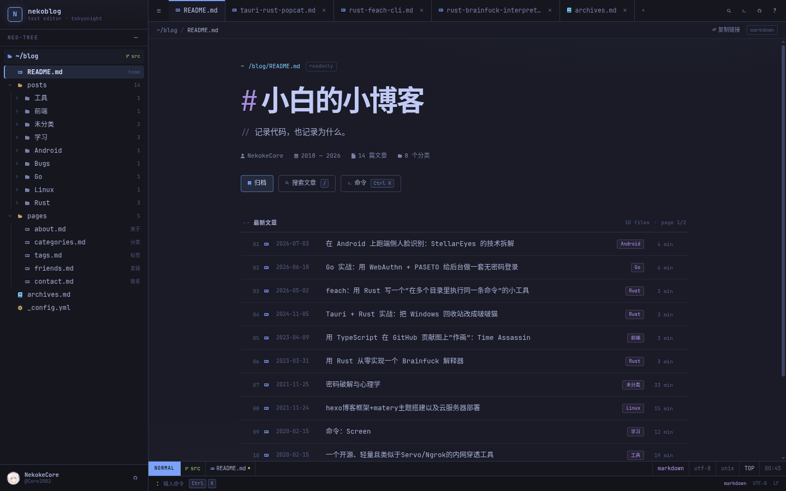
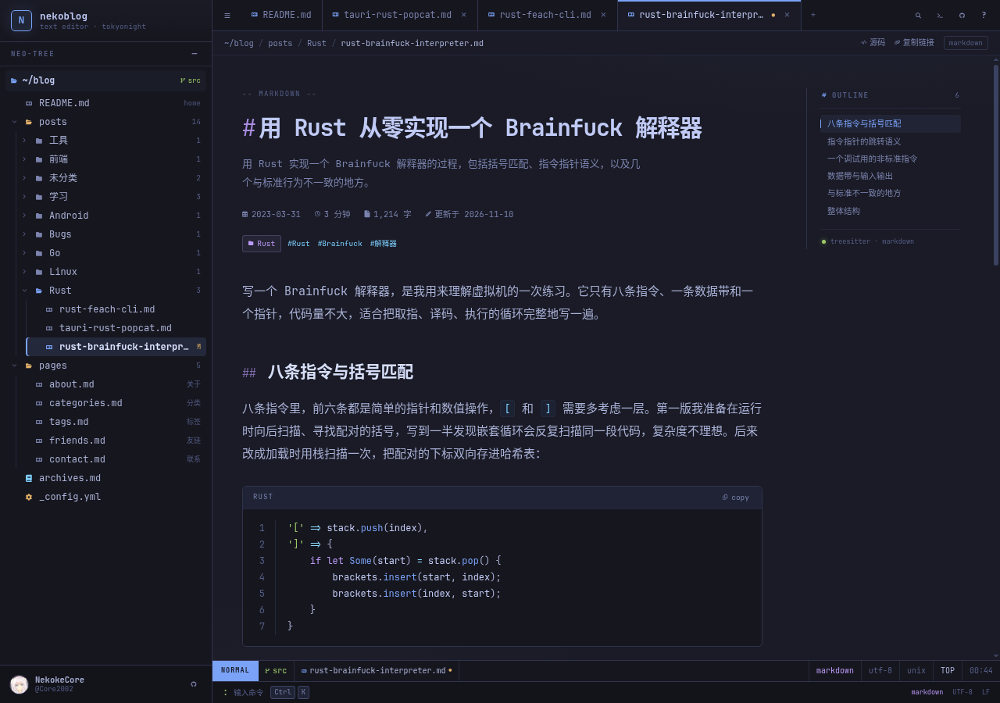
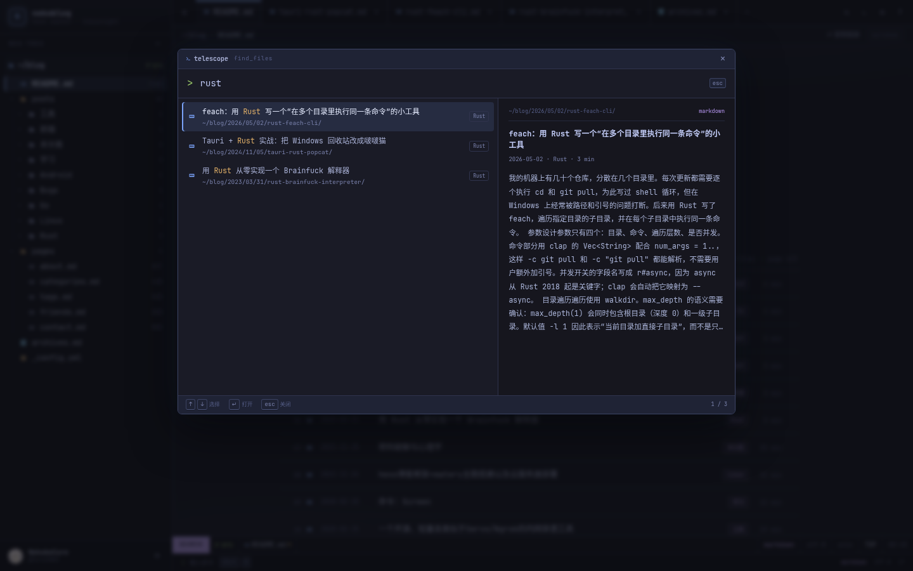

# nvim — a text-editor theme for Hexo

把博客做成一扇 Neovim 窗口：左侧是 **neo-tree**，顶部是 buffer 标签栏，底部是 lualine 状态栏和命令行，文章页右侧是 outline。配色为 **Tokyo Night**，所有字体、图标、脚本都本地加载，不依赖 CDN。



## 特性

- **neo-tree 文件树**：按分类自动生成 `posts/<分类>/<slug>.md`，支持折叠、全部折叠、状态记忆、当前 buffer 高亮；小屏下变成抽屉。
- **bufferline**：打开过的文章/页面会保留在顶部 buffer 标签栏（localStorage），支持关闭标签、来回切换和快捷打开命令面板。
- **winbar 面包屑 / lualine 状态栏**：显示路径、分支、文件类型、编码、阅读进度和实时时钟。
- **telescope 风格命令面板**：`/` 搜索文章与页面，`:` 执行命令，`?` 查看 keymap；支持方向键、回车、懒加载全文预览。
- **文章页**：右侧 TOC outline 滚动高亮（桌面与横屏平板固定显示）、markdown `#`/`##` 标题标记、代码行号与复制按钮、图片灯箱、代码高亮（Tokyo Night）、上一篇/下一篇。
- **归档 / 分类 / 标签 / 友链 / 关于 / 联系** 都有对应布局，保留原有内容与链接。
- **完全响应式**，支持键盘操作、`prefers-reduced-motion`、打印样式；无第三方运行时依赖。

| 文章页 | 命令面板 |
| --- | --- |
|  |  |

归档页与移动端：[归档](preview/archive.png) · [移动端](preview/mobile.png)

## 安装

1. 把 `themes/nvim` 放进 Hexo 站点的 `themes/` 目录。
2. 在站点根目录 `_config.yml` 中启用：

```yaml
theme: nvim
```

3. 建议同时开启代码行号，并关闭归档分页（让归档页一次展示全部文章）：

```yaml
prismjs:
  line_number: true

archive_generator:
  per_page: 0
```

4. 主题配置可以写在 `themes/nvim/_config.yml`，也可以像本仓库一样在站点 `_config.yml` 的 `theme_config` 中覆盖：

```yaml
theme_config:
  brand:
    name: nekoblog
    root: ~/blog
  profile:
    name: NekokeCore
    handle: Core2002
    avatar: /images/avatar.png
    bio: 记录代码，也记录为什么。
  social:
    github: https://github.com/Core2002
  repo:
    url: https://github.com/Core2002/blog
    branch: src
  footer:
    since: 2020
```

### 配置说明

| 键 | 说明 |
| --- | --- |
| `brand.name` / `brand.root` / `brand.logo` | 侧栏品牌名、根目录显示、logo 字符 |
| `profile.name` / `handle` / `avatar` / `bio` | 首页、侧栏、关于页使用的资料 |
| `social.github` / `email` / `twitter` / `bilibili` / `zhihu` | 社交链接，留空即隐藏 |
| `repo.url` / `repo.branch` | “源码 / 编辑此页 / 分支”链接的仓库地址 |
| `pages.*` | `pages/` 目录里的中文名，同时决定排序 |
| `outline.enable` / `min_depth` / `max_depth` | 文章右侧大纲 |
| `home.section` | 首页列表标题 |
| `footer.since` | 关于页里的建站年份 |
| `inject_head` / `inject_body` | 原样插入的自定义 HTML |
| `analytics` | 原样插入 `<head>` 的统计代码 |

## 快捷键

| 按键 | 行为 |
| --- | --- |
| `/` | 搜索文章、标签、页面 |
| `:` | 命令面板 |
| `Ctrl K` / `Cmd K` | 命令面板（同上） |
| `?` | keymap / 全部命令 |
| `Ctrl B` / `Cmd B` | 显示 / 隐藏 neo-tree |
| `j` / `k` | 向下 / 向上滚动 |
| `gg` / `G` | 顶部 / 底部 |
| `g h` | 首页 |
| `g a` | 归档 |
| `g c` | 分类 |
| `g t` | 标签 |
| `g f` | 友链 |
| `g o` | 关于 |
| `g m` | 联系 |
| `Esc` | 关闭面板 / 抽屉 / 灯箱 |

## 目录结构

```text
themes/nvim/
├── _config.yml
├── layout/
│   ├── layout.ejs
│   ├── index.ejs / post.ejs / page.ejs / about.ejs / contact.ejs
│   ├── archive.ejs / category.ejs / tag.ejs / categories.ejs / tags.ejs
│   ├── friends.ejs
│   └── _partial/        # head, sidebar, tabline, winbar, outline, palette…
├── source/
│   ├── css/nvim.css
│   ├── js/nvim.js
│   ├── fonts/           # JetBrains Mono Nerd Font 子集 + OFL
│   └── favicon.svg / favicon.png
└── preview/
```

## 实现说明

- **搜索索引**：构建时把文章标题、路径、日期、分类、标签、摘要写进 `#nvim-data`；命令面板打开时才按需拉取 `content.json` 做全文预览。因此需要 `hexo-generator-json-content`（本仓库已在依赖里）。
- **字体**：`source/fonts/nvim-mono-*.woff2` 只包含 ASCII、标点、箭头和 42 个 Nerd Font 图标，单个约 30 KB；中文自动回退到系统的 Noto Sans CJK / 苹方 / 微软雅黑。字体基于 JetBrains Mono Nerd Font，遵循 SIL OFL 1.1，许可证见 `source/fonts/OFL.txt`。
- **本地状态**：文件树展开/折叠、桌面侧栏显隐、已打开的 buffer 都记录在 `localStorage`（`nvim.tree.state`、`nvim.tree.collapsed`、`nvim.buffers.v1`）。
- **无 JS**：文件树全部展开，文章仍可正常阅读；搜索/命令面板不可用。
- **没有迁移** 原主题的音乐播放器、评论、打赏、梦幻语句等部件。评论可以自行接入 Giscus/Valine；需要时在 `post.ejs` 的 `post-foot` 后加一个容器即可。
- 主题只提供深色 Tokyo Night，不做明暗切换。
- 原 Matery 主题仍保留在 `themes/matery`；切换主题时旧 `theme_config` 已被 nvim 配置替换，需要回退时从 git 历史恢复即可。

## License

主题代码可自由修改使用。内置字体为 SIL OFL 1.1；预览图来自本仓库站点内容。
